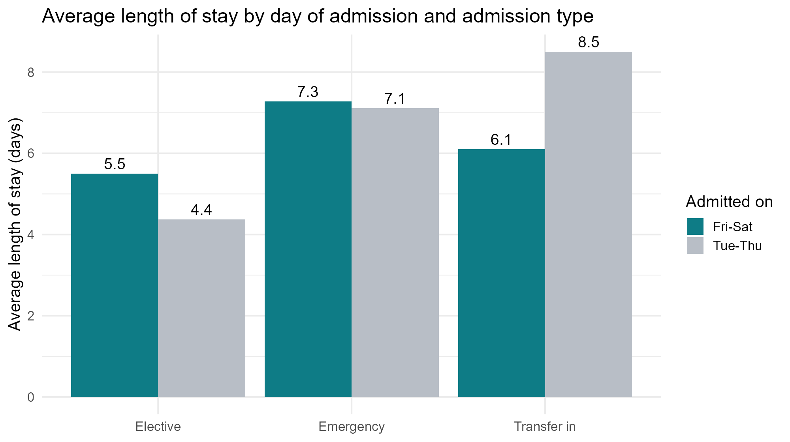
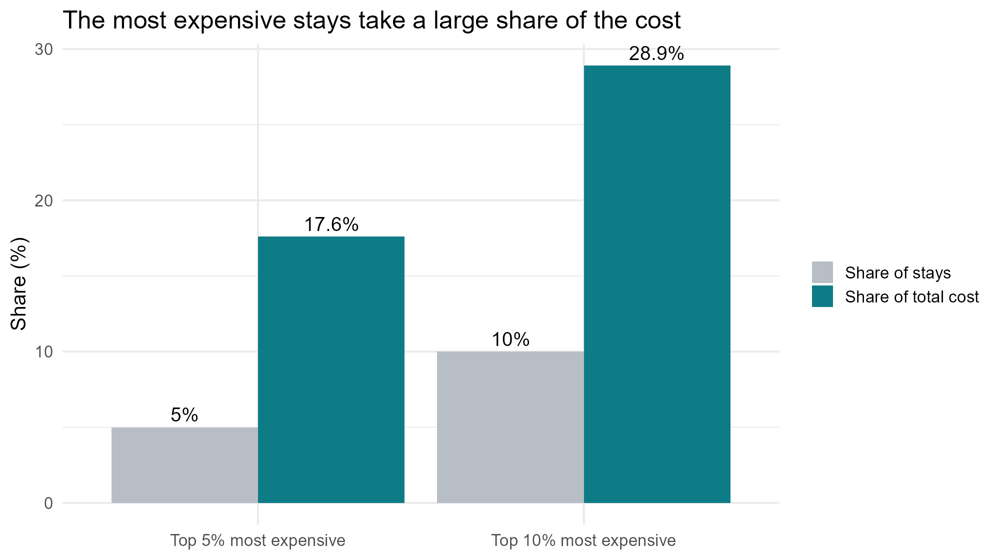
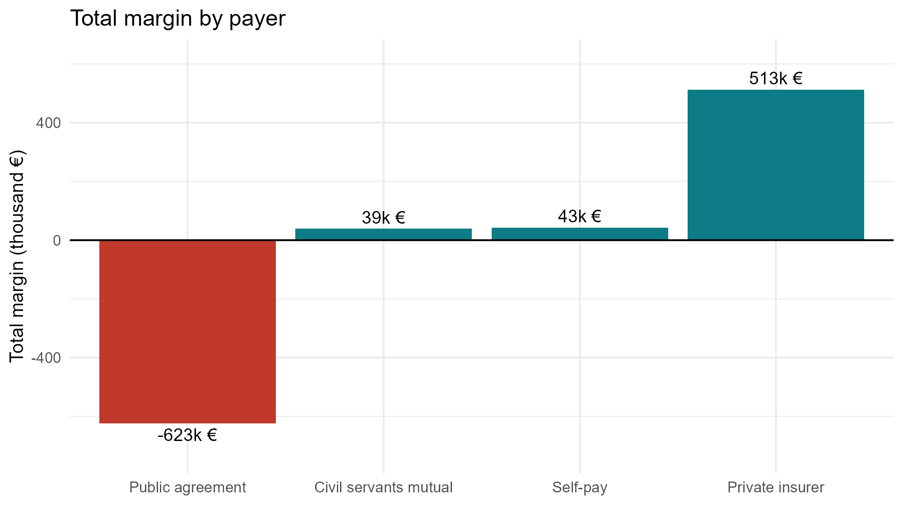

# Hospital Operations Analysis: Admissions, Length of Stay and Cost

Analysis in R of 2,700+ hospital stays: data cleaning, clinical outcomes, length of stay, cost concentration and margin by payer, ending with business recommendations.

**[📄 Read the full report](https://juanmariarodriguez2-png.github.io/hospital-admissions-analysis-r/)** · [R Markdown source](hospital_analysis.Rmd)


---

## Key findings

**1. Weekend admissions only *look* longer.** Patients admitted on Friday or Saturday stay 7.15 days on average, against 6.54 for Tuesday–Thursday (+0.61 days). Split by admission type, the gap shrinks to 0.17 days for emergencies and reverses for transfers. The real cause is the patient mix: 22.2% of Tuesday–Thursday admissions are short planned stays, against only 5.2% on Friday–Saturday.



**2. A few stays drive the cost.** The 5% most expensive stays account for 17.6% of total cost, and the top 10% for 28.9%. Intensive care explains much of it: 35.8% of the top 5% went through the ICU, against 6.2% of all stays.



**3. One payer loses money.** Stays paid under the public agreement generate a loss of €623k (44% of them lose money), while private insurers bring a margin of €513k.



**4. Length of stay jumps from age 45.** It almost doubles from 2.7 days (18–44) to 5.1 days (45–64) and reaches 12 days for patients aged 85 or more.

**5. One day less for joint replacements.** Cutting one day from the 177 knee and hip replacements frees 177 bed-days (about €190k), enough for 42 more operations of this type.

---

## What the analysis covers

| Section | Content |
|---|---|
| Data quality | 8 duplicated rows removed, 22 inconsistent department labels unified, 4 stays with negative length removed, 1 impossible age (121) set to missing, missing values checked against admission type |
| Q1–Q2 | Complication rate by department; mortality by admission type and severity |
| Q3–Q5 | Admissions by weekday; length of stay by age band; the weekend effect and patient mix |
| Q6–Q7 | Cost concentration and ICU use; margin by payer |
| Q8 | Custom function + loop to label every stay (Short / Normal / Long / Very long) and compare costs |
| Q9 | Checking whether the data can answer a question (patient satisfaction: it cannot, and what data would be needed) |
| Q10 | What-if: savings and freed capacity from shorter joint-replacement stays |
| Conclusions | Five findings, each with a recommendation for hospital management |

Every chart uses one colour for the message and grey for the context, and every figure in the text is computed inline, so the report updates if the data changes.

## Tools

R · dplyr · tidyr · ggplot2 · lubridate · R Markdown (knitted to HTML)

## Repository structure

```
hospital_analysis.Rmd   R Markdown source (cleaning, analysis, charts, conclusions)
index.html              Rendered report (published with GitHub Pages)
charts/                 The eight charts exported from the analysis
```

## Data

A synthetic teaching dataset of hospital admissions (July 2025 – June 2026) provided by the course, one file per group, with errors planted on purpose for the cleaning section. It does not describe real patients and is not included in this repository. To run the analysis, place the file as `Group_7.csv` next to `hospital_analysis.Rmd` and knit.

## Context

Group project for *R & Python Programming for Business and Management* (Minor in Data Science), CUNEF Universidad, November 2026.

**Team:** Adriana Bonanca García · Fernando Herráiz Nieto Márquez · Juan María Rodríguez Estrada
